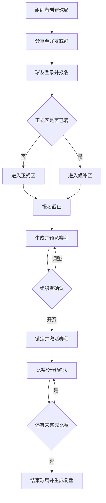
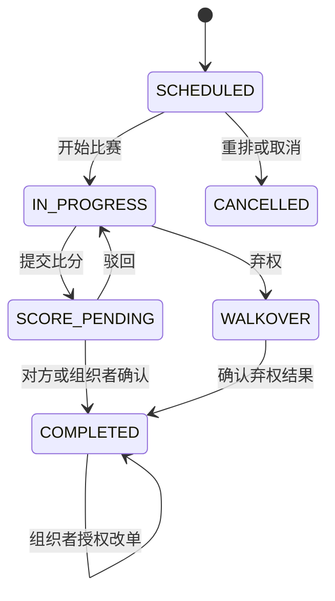

# 页面、交互与状态机

## 1. 页面地图

### 主包

- 登录/授权引导
- 首页：进行中、待开赛、历史球局
- 球局详情：比赛、排名、对阵、裁判四个页签
- 我的：资料、我发起的、我参加的

### 球局分包

- 创建/编辑球局
- 报名确认
- 名单管理
- 开赛配置
- 对阵预览
- 重排影响预览
- 比赛详情
- 计分页
- 比分确认/修改
- 赛后复盘

主包只放高频入口和必要组件，管理、算法配置和复盘放入分包。

## 2. 核心流程

## 3. 球局状态机

| 状态 | 含义 | 允许进入 |
|---|---|---|
| `DRAFT` | 草稿，仅组织者可见 | `REGISTRATION_OPEN`, `CANCELLED` |
| `REGISTRATION_OPEN` | 报名中 | `REGISTRATION_CLOSED`, `CANCELLED` |
| `REGISTRATION_CLOSED` | 报名截止，可生成赛程 | `SCHEDULE_READY`, `REGISTRATION_OPEN`, `CANCELLED` |
| `SCHEDULE_READY` | 已生成赛程但未开赛 | `IN_PROGRESS`, `REGISTRATION_CLOSED`, `CANCELLED` |
| `IN_PROGRESS` | 比赛进行中 | `FINISHED`, `CANCELLED` |
| `FINISHED` | 已结束，只读复盘 | 无 |
| `CANCELLED` | 已取消 | 无 |

所有状态变化由服务端校验。客户端不能通过跳转页面绕过状态约束。

## 4. 报名状态机

`REGISTERED`（正式）与 `WAITLISTED`（候补）是有效状态；`CANCELLED`、`REMOVED`、`WITHDRAWN` 是历史状态。

- 用户主动取消：`REGISTERED/WAITLISTED -> CANCELLED`。
- 组织者移除：`REGISTERED/WAITLISTED -> REMOVED`。
- 开赛阶段退出：`REGISTERED -> WITHDRAWN`。
- 候补转正：`WAITLISTED -> REGISTERED`，保留原候补序号和转正时间。

## 5. 比赛状态机

## 6. 四页签设计

### 6.1 比赛

- 球局名称、时间、地址、规则、人数和状态。
- 正式名单、候补名单及本人状态。
- 报名、取消、转发和组织者管理入口。
- 开赛后突出当前轮次和本人下一场，不再以报名按钮为主操作。

### 6.2 排名

- 名次、头像昵称、胜负、积分、总得分、失分。
- 显示并列名次和排序规则说明。
- 点击球员进入本球局个人复盘。
- 未产生有效比分时展示空排名而不是虚假名次。

### 6.3 对阵

- 顶部切换“当前/下一轮/全部”。
- 按轮次和场地展示双方四名球员、状态和比分。
- 本人比赛使用明显标识。
- 组织者可以管理未开始比赛；普通用户只能查看。

### 6.4 裁判

- 展示待认领、我负责、已完成。
- 只有未上场人员可以认领裁判；组织者不受此限制。
- 一名裁判同一时间只能负责一场进行中的比赛。

## 7. 临时退出重排流程

1. 组织者标记人员退出、暂停或新增人员。
2. 服务端基于当前激活赛程版本生成候选版本，不立即生效。
3. 预览页展示：受影响比赛、人员场次数变化、重复搭档变化、连续休息变化。
4. 组织者确认时提交候选版本号和当前激活版本号。
5. 若期间有比赛已开始或比分变化，返回版本冲突并要求重新预览。
6. 确认成功后，只替换原来 `SCHEDULED` 的比赛。

## 8. 弱网交互

- 所有提交按钮点击后立即锁定，并显示明确的提交中状态。
- 网络超时允许重试，但沿用同一个幂等键。
- WebSocket 断开时退化为定时拉取；恢复后用事件序号补齐消息。
- 客户端接到比当前版本更旧的数据时不得覆盖新状态。

