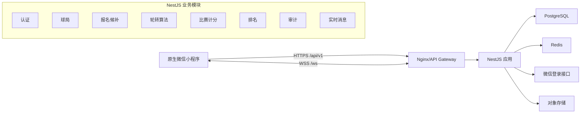

# 系统架构与数据设计

## 1. 总体架构



首版采用模块化单体，不拆微服务。算法模块保持纯 TypeScript、无数据库依赖，便于测试和未来独立部署。

## 2. 工程建议

```text
badminton/
  miniprogram/                 # 原生微信小程序
    miniprogram/
      pages/
      packages/event/
      components/
      services/
      stores/
      types/
      utils/
    tests/
  server/                      # NestJS
    src/
      modules/auth/
      modules/users/
      modules/events/
      modules/registrations/
      modules/schedules/
      modules/matches/
      modules/rankings/
      modules/realtime/
      modules/audit/
      common/
    test/
  packages/
    contracts/                 # DTO、枚举、事件定义
    rotation-engine/           # 纯算法包
  infra/
    docker/
    nginx/
    migrations/
  docs/design/
```

小程序不得直接复用包含 Node.js API 的后端代码；`contracts` 只发布纯类型、枚举和校验规则的安全子集。

## 3. 数据设计原则

- 主键使用 UUID/ULID，接口中一律按字符串传输。
- 时间使用 PostgreSQL `timestamptz`，统一保存 UTC。
- 金额字段只用于展示时仍使用整数分，避免浮点误差。
- 用户、参赛者、报名记录分离，支持代报名与赛后快照。
- 赛程和比分不可覆盖式更新，使用版本及审计记录。
- 软删除只用于确有恢复需求的数据；历史报名通过状态保留。

## 4. 核心表

### 4.1 `users`

| 字段 | 类型 | 说明 |
|---|---|---|
| `id` | uuid PK | 业务用户 ID |
| `openid` | varchar unique | 当前小程序唯一标识，加密存储或受控访问 |
| `unionid` | varchar nullable | 满足条件时保存 |
| `nickname` | varchar | 用户设置的昵称 |
| `avatar_url` | text nullable | 头像地址 |
| `gender` | enum | `MALE/FEMALE`，必填后才能报名 |
| `level` | varchar nullable | 自报水平 |
| `status` | enum | `ACTIVE/DISABLED` |
| `created_at/updated_at` | timestamptz | 时间戳 |

### 4.2 `events`

| 字段 | 类型 | 说明 |
|---|---|---|
| `id` | uuid PK | 球局 ID |
| `organizer_id` | uuid FK | 组织者 |
| `title` | varchar | 名称 |
| `status` | enum | 球局状态 |
| `play_mode` | enum | 首版 `FREE_ROTATION` |
| `start_at/end_at` | timestamptz | 活动时间 |
| `registration_deadline` | timestamptz | 报名截止 |
| `cancellation_deadline` | timestamptz | 取消截止 |
| `venue_name/address` | varchar/text | 场馆信息 |
| `latitude/longitude` | numeric nullable | 地图坐标 |
| `court_labels` | jsonb | 场地号列表，如 `["1号","2号"]` |
| `capacity` | smallint | 正式人数上限 |
| `waitlist_capacity` | smallint | 候补上限 |
| `level_requirement` | varchar nullable | 水平要求 |
| `gender_requirement` | enum | `ANY/MALE/FEMALE` |
| `fee_cents` | integer nullable | 仅展示，不产生支付 |
| `description` | text nullable | 补充说明 |
| `settings` | jsonb | 算法、分制等扩展设置 |
| `version` | integer | 乐观锁版本 |
| `created_at/updated_at` | timestamptz | 时间戳 |

`settings` 首版结构包括：

```json
{
  "scoreTo": 21,
  "finishRule": "DEUCE_WITH_CAP",
  "scoreCap": 30,
  "targetMatchesPerPlayer": 8,
  "avoidRepeatPartner": true,
  "avoidRepeatOpponent": true,
  "avoidConsecutivePlay": true,
  "genderPolicy": "PREFER_MIXED",
  "forbidMensVsWomens": false
}
```

### 4.3 `event_participants`

代表球局内的人员快照，不等同于用户账户。

| 字段 | 类型 | 说明 |
|---|---|---|
| `id` | uuid PK | 参赛者 ID |
| `event_id` | uuid FK | 球局 |
| `user_id` | uuid nullable FK | 代报名时可为空 |
| `display_name/avatar_url` | varchar/text | 球局内快照 |
| `gender` | enum | 必填 |
| `level` | varchar nullable | 水平快照 |
| `created_by` | uuid FK | 本人或代报名人 |
| `presence_status` | enum | `ACTIVE/LATE/PAUSED/WITHDRAWN` |
| `created_at/updated_at` | timestamptz | 时间戳 |

约束：同一 `event_id + user_id` 在 `user_id` 非空时唯一。

### 4.4 `registrations`

| 字段 | 类型 | 说明 |
|---|---|---|
| `id` | uuid PK | 报名记录 |
| `event_id/participant_id` | uuid FK | 球局和参赛者 |
| `status` | enum | 正式、候补、取消、移除、退出 |
| `queue_no` | bigint | 全局递增排队序号 |
| `registered_at` | timestamptz | 报名成功时间 |
| `promoted_at/cancelled_at` | timestamptz nullable | 状态时间 |
| `operator_id` | uuid FK | 最近操作者 |
| `reason` | text nullable | 移除/退出原因 |
| `version` | integer | 乐观锁 |

索引：`(event_id, status, queue_no)`，用于人数统计和候补转正。

### 4.5 `schedule_versions`

| 字段 | 类型 | 说明 |
|---|---|---|
| `id` | uuid PK | 赛程版本 |
| `event_id` | uuid FK | 球局 |
| `version_no` | integer | 球局内版本号 |
| `status` | enum | `DRAFT/PREVIEW/ACTIVE/SUPERSEDED` |
| `base_version_id` | uuid nullable | 重排来源 |
| `algorithm_version` | varchar | 算法版本 |
| `random_seed` | varchar | 可复现种子 |
| `input_snapshot` | jsonb | 人员和配置快照 |
| `metrics` | jsonb | 公平度及冲突说明 |
| `created_by/confirmed_by` | uuid nullable | 操作者 |
| `created_at/confirmed_at` | timestamptz nullable | 时间 |

唯一约束：同一球局最多一个 `ACTIVE` 版本（部分唯一索引）。

### 4.6 `rounds`

- `id`, `schedule_version_id`, `round_no`, `status`, `planned_start_at`。
- 唯一约束：`schedule_version_id + round_no`。

### 4.7 `matches`

| 字段 | 类型 | 说明 |
|---|---|---|
| `id` | uuid PK | 比赛 ID |
| `event_id/round_id/schedule_version_id` | uuid FK | 所属关系 |
| `court_label` | varchar | 场地号快照 |
| `sequence_no` | integer | 全局比赛序号 |
| `status` | enum | 比赛状态 |
| `team_a_score/team_b_score` | smallint nullable | 当前有效比分 |
| `score_version` | integer | 比分乐观锁 |
| `referee_participant_id` | uuid nullable | 裁判 |
| `started_at/completed_at` | timestamptz nullable | 时间 |
| `result_type` | enum | `NORMAL/WALKOVER` |

### 4.8 `match_players`

- `match_id`, `participant_id`, `side`（A/B）、`slot_no`（1/2）。
- 主键：`match_id + participant_id`。
- 唯一约束：`match_id + side + slot_no`。

### 4.9 `score_submissions`

- 保存尚未确认和已确认的提交：比分、提交者、提交者角色、状态、提交时间。
- `status`: `PENDING/CONFIRMED/REJECTED/SUPERSEDED`。
- 确认后把有效结果投影到 `matches`，但原提交不可删除。

### 4.10 `score_change_logs`

- `match_id`, `before_score`, `after_score`, `reason`, `operator_id`, `created_at`。
- 组织者修改已确认比分时强制写入。

### 4.11 `operation_logs`

- 记录球局状态变化、名单调整、赛程生成/激活、裁判变更、弃权等管理操作。
- 包含 `request_id`、资源类型、资源 ID、操作、前后摘要、操作者和 IP 摘要。

### 4.12 `idempotency_records`

- `user_id + key + route` 唯一。
- 保存请求摘要、响应状态、响应体摘要和过期时间。
- 报名、取消、生成赛程、确认重排、比分提交等操作必须使用。

## 5. Redis 用途

- 短期登录会话或 Refresh Token 轮换状态。
- WebSocket 房间与多实例广播适配器。
- 接口限流计数。
- 排名和球局详情的短期缓存。
- 赛程生成任务锁，防止同一球局并发生成。

报名名额和候补顺序的最终一致性由 PostgreSQL 事务保证，不依赖 Redis 分布式锁作为唯一保障。

## 6. 关键事务

### 报名

1. 锁定 `events` 行并检查状态、截止时间和版本。
2. 检查用户有效报名唯一性。
3. 统计正式/候补有效数量。
4. 创建参赛者和报名记录。
5. 提交事务后广播报名变化。

### 取消和候补转正

1. 锁定球局与目标报名记录。
2. 更新取消状态。
3. 使用 `FOR UPDATE SKIP LOCKED` 取得最早有效候补。
4. 候补转正并写操作日志。
5. 同一事务提交后广播两项变化。

### 比分确认

1. 锁定比赛并检查 `score_version`。
2. 校验操作者权限和比分合法性。
3. 确认提交并更新比赛投影。
4. 写入审计记录。
5. 提交后清除排名缓存并广播比分/排名版本。

